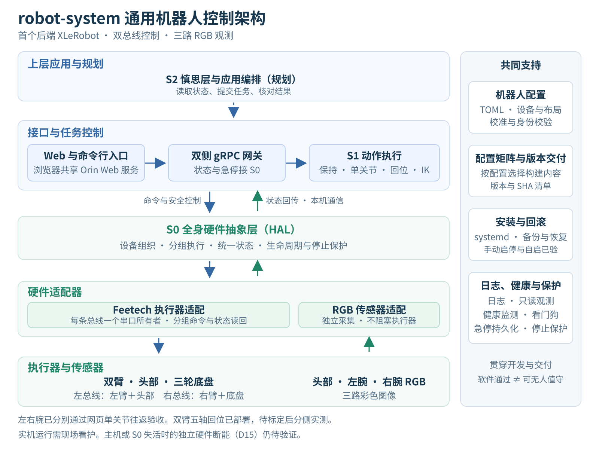

# robot-system

Rust 实现的通用机器人控制架构。当前里程碑是 S0 全身硬件抽象层，XLeRobot 是首个已验证的硬件后端，覆盖双臂、头部、底盘和相机。

分层为 `S1 控制 → S0 HAL → 硬件适配器 → 实际设备`：`robot-core` 定义契约，`robot-s0` 负责硬件组织、执行和生命周期，适配器处理设备协议。执行器命令/状态与相机帧保留独立接口；每条总线一个串口所有者。

| 查什么 | 入口 |
|---|---|
| 当前完成边界和 roadmap | [S0 HAL 状态](docs/s0_hal_status.md) |
| 开发规则与最小验证 | [AGENTS.md](AGENTS.md)、[按需开始](docs/02_start_here.md) |
| 当前配置与测试夹具 | [配置导航](configs/README.md) |
| 服务模板与部署边界 | [systemd 导航](scripts/systemd/README.md) |
| 架构与其他文档 | [文档导航](docs/README.md) |

软件、部署和实机结果分别验收；当前 `D15 OPEN/DEFERRED`、`deployable=false`，不支持无人值守声明。

`0.0.1` 已发布，包含现有配置矩阵打包；S0 受监督功能、systemd 手动启停及真实重启后的双侧保护待机自启均已验；默认不上扭、故障保持锁存。CI 仅在推送 `v` 前缀的 SemVer 标签时运行；普通分支推送和 PR 不触发。发布标签采用 `v0.0.1+<结案提交的7位SHA>`，新版本软件包与已安装实机候选分别记录，不自动替换或启动现场服务。

日常开发仅推送 `dev`；`master` 只接收已验证的正式发布，并绑定对应版本标签。两个远程遵循相同规则。
