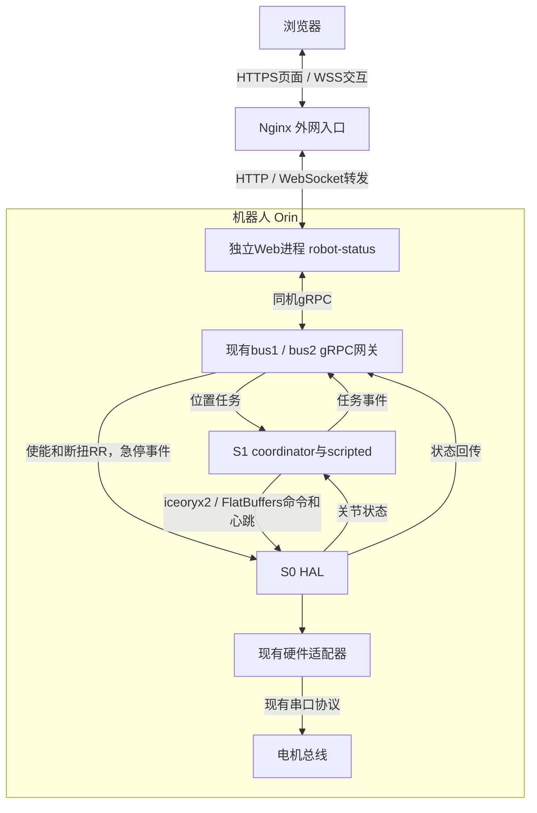

# 对外通讯与控制方案

本文记录已确定的通讯与控制方案：Web服务部署在Orin，浏览器使用WebSocket，内部复用现有gRPC，Nginx只作外网入口，访问管理由用户已有的外部系统承担。当前WebSocket只读状态页及三路低帧率相机预览已部署，不要求Web令牌；两总线有效关节反馈、真实画面和外网接入已验证。动作控制尚未接入；安装与验收边界见[当前状态的TODO](s0_hal_status.md#通讯与控制todo)。

## 通讯链路

下图为完整目标链路；当前Web只接状态查询，外网入口由用户维护，控制路径尚未接入页面。



- Web页面与后端都部署在Orin，沿现有`robot-rpc`中的独立`robot-status`程序运行；HTTP加载页面，WebSocket目前只推送状态，控制请求、回执及任务事件按TODO后续接入。旧SSE推送已删除，不增加crate或另一套网关框架。
- Web后端调用同机现有gRPC；外部程序或CLI继续沿既有gRPC使用方式。浏览器只提交目标与时长，不实现运动插值、连续电机控制帧或串口读写。WebSocket转换复用既有业务语义，不重新定义动作、任务和停止协议。
- 机器人本机继续使用iceoryx2和FlatBuffers。状态查询、使能、断扭、急停不经过S1；位置任务由S1执行，再交S0。每条总线只有一个S0串口所有者、命令流和停止域，Web和网关不进入RT线程，也不成为S0启动依赖。
- Nginx只负责外网HTTPS/WSS入口及转发，不运行机器人业务、保存任务或执行动作，由用户在其他配置中维护。内部gRPC保持本机监听，不另开公网控制端口。Web默认loopback，也允许显式IPv4 RFC1918私网地址；当前Orin部署候选使用`10.0.1.40:8080`供现有Nginx访问，不接受通配或公网监听，不新建隧道服务。
- **Web接入管理交给用户已有的外部系统。** 已删除Web令牌表单、Bearer访问校验及其角色表配置，不另建登录、令牌签发、账号或接入权限系统。当前`GetState`本就不要求令牌；内部既有控制RPC的权限、元数据和机器人控制校验保持原实现，浏览器不承担内部RPC凭据配置。
- 每个动作沿既有`CommandMeta`、请求标识、权限、截止时间和幂等规则。超时先查询原任务；结果未知不自动重发。截止时间由机器人侧时钟换算，不使用浏览器时钟代替`RobotClock`。
- 浏览器断连不等于电机已停。首版仅有限时长的单次定位，不做连续拖动或长按点动；本机S1/S0按既有心跳和命令超时合同处理。重连查询真实状态，不续发旧目标。

## 已有对外接口

定义见[robot_control.proto](../crates/robot-rpc/proto/robot_control.proto)，CLI已有[调用与payload构造](../crates/robot-cli/src/dispatch.rs)。下表表示代码能力，不表示已接入当前全总线部署。

| 能力 | 已有接口 | 当前边界 |
|---|---|---|
| 状态查询与订阅 | `GetState`、`StreamState` | 按hardware返回位置、模式、控制链路、输出模式、安全状态、故障码及时间戳；无逐电机`Torque_Enable`字段 |
| 使能与断扭 | `SetEnabled(true/false)` | 单S0所选hardware范围；当前bus1为左臂＋头部，bus2为右臂＋底盘，不是单电机开关 |
| 位置任务 | `InvokeTask(kind=Scripted)` | 完整关节位置向量，单位rad，指定插值时长；尚无按关节名修改单个目标的请求语义 |
| 任务查询与事件 | `GetTaskStatus`、`StreamTaskEvents` | 可查询原任务和接收终态；任务结束不能直接当作实测到位 |
| 取消任务 | `CancelTask` | 合作式取消；当前可能返回启动锚点保持，不能标为“停止当前位置” |
| 急停与解除 | `EStop`、`ClearEStop` | 急停Ack只证明事件发布；解除急停为独立maintainer操作，不自动使能 |

设备列表、总线身份、关节名称、物理ID和模式来自[现有TOML](../configs/README.md)，不另存一套映射。现有RPC尚无设备枚举接口，Web入口已将必要只读元数据与状态一起返回；后续控制限位仍须沿原校准和配置校验。

## 单电机位置控制还缺什么

最小请求表达“所选总线/hardware、关节名称、目标位置rad、运动时长”。界面可显示角度，但传输单位明确为rad；物理ID只用于展示与配置映射，不能用跨总线重复的裸ID定位设备。这是待补请求语义，当前没有可直接调用的单关节API。

1. **在S1接受任务时补齐目标。** 沿现有单任务串行入口，取得一份新鲜、完整且layout匹配的关节快照，以它构造起点和保持目标，只修改选中位置关节，再复用[scripted](../crates/robot-s1/src/action_backend/scripted.rs)。不能由浏览器或网关用旧状态拼完整目标数组；现有全向量请求与S1提交快照之间的时差尚未解决。只补必要的类型化请求与转换，不新建运动后端；具体wire变更实施前核对兼容性并登记，不在本文假定已有新RPC或schema。
2. **限制目标和执行范围。** 校验关节模式、配置/校准限位、有限数值、时长及所需运动速率；明确缺失的参数后才能开放动作，不任意放宽边界。现有raw校准边界容差不直接当作新的运动范围或到位容差。首版只开放双臂、夹爪和头部的位置关节，三轮保持raw0；不提供轮位置控制。每条总线一次一个任务，忙时拒绝，不增加队列；首次实机先左侧再右侧，不做双总线同时动作。
3. **补齐实测到位确认。** 现有Scripted成功只保证末目标已发布，见[实现](../crates/robot-s1/src/action_backend/scripted.rs)。将“请求接收、轨迹发送结束、实测到位”分开；使用后续新鲜反馈、明确的位置误差与稳定窗口确认到位，超时或反馈缺失报告未确认。其余位置关节保持目标和三轮零速也要纳入相应验证，不能只检查选中关节。
4. **明确取消与停止收尾。** 当前取消及失败路径会把Idle/Degraded保持目标重置为启动锚点，见[coordinator](../crates/robot-s1/src/coordinator.rs)。首次位置动作前必须明确处置并离线验证该回拉行为；首版操作明确提供停用/断扭和急停，不用`CancelTask`冒充停止，也不由Web静默改写原语义。若需“取消后保持当前位置”，先登记契约与验收影响，再改实现。停用后复用原停止读回，迟到的任务/使能回执不得重新上扭。

单关节移动不等于仅该电机使能。第一版沿总线使能，明确显示受影响关节；逐电机独立使能及扭矩读回不纳入此轮。

## 最小管理页与状态语义

当前页面只有两总线状态卡片、由配置生成的关节表、反馈位置和保护状态。后续控制仍在同页最小补齐目标位置、运动时长、执行与任务结果，以及使能、停用/断扭、急停；解除急停单独处理。业务拒绝显示实际原因，不自动清故障或启用电机。

| 显示 | 判断依据 |
|---|---|
| 服务在线、软件使能、扭矩状态 | 分开呈现；服务在线不证明上扭，`Safe`不证明已经断扭 |
| 已请求停止 / 已确认断扭 / 停止失败 / 未确认 | 沿`StopCommanded`、`TorqueOffConfirmed`、`StopFailed`、`TorqueUnknown/AdapterUncertain`，不把总线结果复制为每个电机的独立确认 |
| 当前数据 / 陈旧 / 无反馈 | 用机器人侧源时间戳及是否推进判断；`StreamState`重复发缓存不算新采样，浏览器接收时间不证明反馈新鲜 |
| 任务结束 / 已到位 | 前者来自任务事件，后者必须有实测误差和稳定窗口结果 |

0.1.0部署已恢复S1所需的健康关节反馈；当前仍为EStop锁存的断扭待机，不能直接当作允许动作。后续使能必须先准备内部控制权限、启动锚点和现场条件，沿既有恢复与停止入口，不另造旁路。

当前开发分支新增[bus1 S1模板](../scripts/systemd/robot-s1-bus1.service)，复用bus1配置的8关节、`scripted` profile与全总线身份，依赖`robot-s0-bus1`，普通线程限制CPU0–3；尚未安装或启动。旧arm-only模板仍被兼容入口引用，不用于当前全总线部署。S0正式发布及D15边界保持不变。

左侧保持入口复用`supervised_demo --phase hold --side left`：取本次S1进程日志中的实际启动锚点，固定保持20秒、逐样本检查±4raw，再确认`Safe/TorqueOffConfirmed/fault0`。不调用任务、不另发关节命令；S1仍是唯一命令发布者。启动锚点和常驻缓存共用强制layout、数量、新鲜度及有限位置检查，首次坏帧直接失败，不用旧帧或零位替代。

正式Web网关继续只读；实机准备沿现有维护入口暂起同机控制网关与S1，单独执行原`ClearEStop`，结束后恢复急停锁存、退出临时进程，并完成原整机停止检查。候选、具体脚本、预检与当次现场确认完成后才允许启用；软件通过不等于左侧动作验收。

## 当前只读WebSocket入口

在现有`robot-rpc`中启用`status-web`构建`robot-status`，不改变`robot-gateway`默认构建，也不加入S0 0.0.1包。静态页直接内嵌，无前端构建工具。使用独立产物目录：

```bash
CARGO_TARGET_DIR="$PWD/target/verify-status" cargo build -p robot-rpc --features status-web --bin robot-status --bin robot-gateway
target/verify-status/debug/robot-status --config configs/xlerobot-status.toml
```

程序只读取配置、本机gRPC和已有RGB观测镜像。`http://127.0.0.1:8080`不要求输入token，页面通过同源`/api/ws`接收JSON快照；HTTPS页面自动使用WSS。远程查看可仅转发HTTP端口，例如`ssh -L 8080:127.0.0.1:8080 robot-mesh`；页面后端和两个网关必须运行在同一主机，不能将gRPC经远端转发后比较不同时钟域。

Orin的HTTP上游为`http://10.0.1.40:8080`。用户侧Nginx原样转发`/`、`/api/state`、`/api/ws`以及相机的`/api/cameras`和`/api/cameras/{id}/frame`，WebSocket使用HTTP/1.1并传递`Upgrade`和`Connection: upgrade`，关闭代理缓冲，读取超时可设60秒；具体行为见[Nginx官方说明](https://nginx.org/en/docs/http/websocket.html)。已配置的外网地址见[当前状态](s0_hal_status.md#通讯与控制todo)，各域名使用同源WSS。本项目不安装或重载用户的Nginx，不转发gRPC端口。

状态入口为`GET /`、`GET /api/state`与`GET /api/ws`，原`/api/events`返回404；相机使用下述独立HTTP入口。WebSocket立即返回最新快照并持续更新，收到客户端Text/Binary消息以1008关闭，不提供动作或配置写入。固定轮询任务按配置调用`GetState`，浏览器数量不增加RPC读取。最多8个WebSocket连接，每连接只取最新快照，写入最多等待500毫秒；输入帧/消息上限1KiB，输出快照上限64KiB。断开和退出回收任务；无首帧、连接失败、源时间戳重复/回退、布局或身份错配分别保留真实状态，不用收包时间续鲜。

`xlerobot-status.toml`引用原总线TOML，以配置所在目录解析相对路径，身份、8/9槽位、关节名与ID沿原文件派生。默认500ms轮询、2000ms陈旧阈值只影响页面展示，不修改S0/S1的控制、超时和停止合同。轮子标为原始速度模式，不显示位置角度；尚无每电机扭矩读回。

新的[bus1网关模板](../scripts/systemd/robot-gateway-bus1.service)、[bus2网关模板](../scripts/systemd/robot-gateway-bus2.service)和[状态页模板](../scripts/systemd/robot-status.service)只对齐配置与启动顺序，不自动启动S0/S1；沿现有安装器部署，开机自启需单独安排。原arm-only模板继续供已有兼容入口使用，不改动它们。

`robot-status`独立于S0/S1进程，单独重启和回收。状态页unit设置CPU0–3、合计半核CPU预算、128MiB内存软限制、256MiB硬限制及32个OS任务上限，避开S0通讯核4/5。实际限额及三路预览的短时负载已在Orin核对，结果见当前状态，不据此推断长期负载峰值；Web工作不进入RT线程。

## 相机预览

复用已有RGB的`ImageHeader`与图像数据通讯链路，只打开既有观测镜像，不创建正式topic、不再次打开相机或改变采集参数。相机身份和topic由状态源引用的原总线TOML中`robot.id`与`sensor.id`派生，当前为头部、左腕、右腕三路；`GetState`仍不含图像。

`xlerobot-status.toml`的`[preview]`控制预览：`enabled`、`interval_ms`（1000–60000）、`max_width`（1–640）、`max_height`（1–480）、`jpeg_quality`（1–95）和`stale_after_ms`（不小于interval，至多120000）。默认示例为1Hz、320×240、质量70和3秒陈旧阈值；缩图保持比例、不放大。旧配置缺少该表时默认禁用，不新增订阅。

`GET /api/cameras`返回启用状态、刷新间隔及相机列表；`GET /api/cameras/{id}/frame`返回最新JPEG及`X-Frame-Stamp-Ns`、`X-Frame-Age-Ms`、`X-Frame-Width/Height`。未知相机返回404，无帧、校验失败或源帧陈旧返回503，所有响应禁止缓存。源时间戳保留字符串，重复收到同帧不会续鲜。网页“查看画面”独立于状态连接；每路单请求、3秒超时，暂停、切后台和离开页面时取消读取并回收图片URL。

一个普通线程拥有三路订阅，有界丢弃旧帧，只将最新帧缩小复制成自有像素后立即归还共享内存，再编码JPEG；浏览器数量不增加编码或内部订阅。每路只缓存最新JPEG，图像请求不进入状态WebSocket队列。独立Web进程继续沿原CPU、内存和任务预算；本轮部署仅替换Web，短时真实图像、连续状态反馈与资源验证通过，不能据此宣称所有内部时序零影响或长期稳定。
