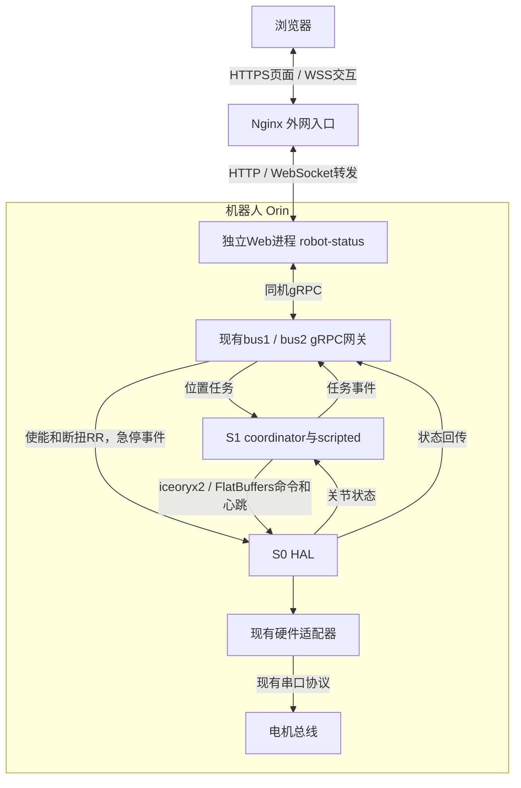

# 对外通讯与控制方案

本文记录已确定的通讯与控制方案：Web服务部署在Orin，浏览器使用WebSocket，内部复用现有gRPC，Nginx只作外网入口，访问管理由用户已有的外部系统承担。当前WebSocket只读状态页及三路低帧率相机预览已部署，不要求Web令牌；两总线有效关节反馈、真实画面和外网接入已验证。动作控制尚未接入；安装与验收边界见[当前状态的TODO](s0_hal_status.md#通讯与控制todo)。

## 通讯链路

下图为完整目标链路；当前Web只接状态查询，外网入口由用户维护，控制路径尚未接入页面。



- Web页面与后端都部署在Orin，沿现有`robot-rpc`中的独立`robot-status`程序运行；HTTP加载页面，WebSocket目前只推送状态，控制请求、回执及任务事件按TODO后续接入。旧SSE推送已删除，不增加crate或另一套网关框架。
- Web后端调用同机现有gRPC；外部程序或CLI继续沿既有gRPC使用方式。浏览器只提交目标与时长，不实现运动插值、连续电机控制帧或串口读写。WebSocket转换复用既有业务语义，不重新定义动作、任务和停止协议。
- 机器人本机继续使用iceoryx2和FlatBuffers。状态查询、使能、断扭、急停不经过S1；位置任务由S1执行，再交S0。每条总线只有一个S0串口所有者、命令流和停止域，Web和网关不进入RT线程，也不成为S0启动依赖。
- Nginx只负责外网HTTPS/WSS入口及转发，不运行机器人业务、保存任务或执行动作，由用户在其他配置中维护。内部gRPC保持本机监听，不另开公网控制端口。Web默认loopback，也允许显式IPv4 RFC1918私网地址；当前Orin部署候选使用`10.0.1.40:8080`供现有Nginx访问，不接受通配或公网监听，不新建隧道服务。
- **Web接入管理交给用户已有的外部系统。** 已删除Web令牌表单、Bearer访问校验及其角色表配置，不另建登录、令牌签发、账号或接入权限系统。当前`GetState`本就不要求令牌；内部既有控制RPC的权限、元数据和机器人控制校验保持原实现，浏览器不承担内部RPC凭据配置。
- 每个动作沿既有`CommandMeta`、请求标识、权限、截止时间和幂等规则。超时先查询原任务；结果未知不自动重发。截止时间由机器人侧时钟换算，不使用浏览器时钟代替`RobotClock`。
- 浏览器断连不等于电机已停。首版仅有限时长的单次定位，不做连续拖动或长按点动；本机S1/S0按既有心跳和命令超时合同处理。重连查询真实状态，不续发旧目标。

## 已有对外接口

定义见[robot_control.proto](../crates/robot-rpc/proto/robot_control.proto)，CLI已有[调用与payload构造](../crates/robot-cli/src/dispatch.rs)。下表表示代码能力，不表示已接入当前全总线部署。

| 能力 | 已有接口 | 当前边界 |
|---|---|---|
| 状态查询与订阅 | `GetState`、`StreamState` | 按hardware返回位置、模式、控制链路、输出模式、安全状态、故障码及时间戳；无逐电机`Torque_Enable`字段 |
| 使能与断扭 | `SetEnabled(true/false)` | 单S0所选hardware范围；当前bus1为左臂＋头部，bus2为右臂＋底盘，不是单电机开关 |
| 位置任务 | `InvokeTask(kind=Scripted)` | 保留原完整向量载荷；新增单关节载荷`0x040F`，指定hardware、关节名、rad目标和时长，复用同一后端。生产配置尚未开放 |
| 任务查询与事件 | `GetTaskStatus`、`StreamTaskEvents` | 新单关节任务成功要求末目标发布后的新鲜反馈连续到位；原完整向量任务成功仍只表示轨迹发送结束 |
| 取消任务 | `CancelTask` | 新单关节任务保持最后成功发布的完整目标；首次发布前保持提交快照。原载荷取消仍回启动锚点；两者都不是断扭或“停止当前位置” |
| 急停与解除 | `EStop`、`ClearEStop` | 急停Ack只证明事件发布；解除急停为独立maintainer操作，不自动使能 |

设备列表、总线身份、关节名称、物理ID和模式来自[现有TOML](../configs/README.md)，不另存一套映射。现有RPC尚无设备枚举接口，Web入口已将必要只读元数据与状态一起返回；后续控制限位仍须沿原校准和配置校验。

## 单关节定位与剩余接入

新载荷表达“所选hardware、关节名称、目标位置rad、运动时长”，沿原`InvokeTask(kind=Scripted)`传递，不增加RPC方法。物理ID只用于展示与配置映射，不能用跨总线重复的裸ID定位设备。CLI为`robotctl invoke single-joint --hardware-id … --joint-name … --target-position-rad … --duration-ms … --audit-reason …`，沿原地址、权限、幂等和任务查询参数；`--timeout-ms`需覆盖运动、到位观察及请求开销。旧程序按schema精确匹配拒绝新载荷，旧`0x040B`完整向量行为不变。

- **提交与约束：** S1在串行提交入口取同一份新鲜、完整、layout匹配且处于使能/上扭/活动/无故障状态的反馈，只替换选中位置关节，其余位置目标取自该快照。`[s1.single_joint]`显式给出每个位置关节的rad范围、速率和到位容差，以及最大运动时长、到位超时和稳定窗口；缺失、名称不全、未知关节、非有限值、编码后越界、速率或期限不足均拒绝。bus2由原`motor_ids`识别六个位置槽及三轮，拒绝选择轮子或为轮子填写位置约束，三轮命令保持raw 0。S0仍执行原校准限制，raw边界容差不转换为运动范围或到位容差。
- **编码与到位：** 位置目标和保持值沿S0现有f32编码；请求原值与编码值都须满足范围和速率限制，不用clamp。首次末目标成功发布后才开始计时；要求后续源时间戳推进、所有位置关节都在各自容差内并跨越稳定窗口。bus2完整九槽反馈仍须有效，轮反馈不参与rad位置到位比较；维护入口同时检查原混合命令镜像的轮目标和raw速度始终为0。重复帧不累计窗口，偏离则重新计时；缺帧、故障、越界、时间回退或超时失败，不把轨迹发送结束当作到位。
- **取消与失败：** 新请求在下一拍收敛，取消不再输出新的轨迹点；取消、期限到期或失败后，Idle/Degraded保持最后成功发布的完整目标。未发布过命令时保持提交快照；发布失败不更新保持目标。这不是实测当前位置保持，也不等于断扭。旧载荷保留原回启动锚点行为；停用、急停和原停止读回仍是独立收尾步骤。

**到位容差按配置，左侧±20raw实机复验通过。** 用户已授权到位误差20raw内通过，现有`s1.single_joint.joints[].tolerance_rad`为唯一来源，允许逐关节不同；正常到位、取消保持及单关节执行走廊统一读取，demo不再另设硬编码4raw。左侧八关节[运动片段](../configs/xlerobot-bus1-motion.toml)使用原Feetech f32换算的±20raw最大差，并严格排除21raw，只供原维护工具与bus1合成候选，不作为完整设备配置安装或自动开放生产请求。原范围、速率、800毫秒超时、200毫秒稳定窗口不变；默认hold及启用前锚点一致性仍沿原检查，校准边界、断扭和停速合同不变。同路径单次主动取消、自动保持与STOP51已通过，用户确认运动及停止；旧试验继续按当时±4raw记录，不回填PASS。

**首轮已仅对左腕旋转关节 ID5 执行一次。** 复用 `supervised_demo --phase single-joint --side left`，以当次 S1 启动锚点为参照，沿原 Feetech 换算增加24 raw，单向定位20秒，不自动回程；左侧另外七关节保持提交快照。临时 S1 配置按当前校准原上下界填写完整八关节约束，到位仍为±4 raw，软件上限0.10 rad/s、到位预算800毫秒、稳定窗口200毫秒。S0的20 raw校准边界容差不变，不用它扩大运动范围。

本次ID5从1009raw请求1033raw，原自动到位检查超时`FAILED`；末目标读回1033、实际1027，偏差−6raw，另外七关节末位置与启动锚点一致。用户明确“全局标准不动，这次算通过”，本次仅按原型闭环验收通过记录，原自动精度失败保留，原±4raw到位门和其他全局标准均不变。现场确认静止，可见微动未明确确认，不能据此证实重力原因。

入口在使能前检查完整锚点、候选范围、编码后目标、步幅、速率和期限。提交一次原 `0x040F` 请求；自动成功仍需独立新鲜反馈确认末点，再断扭，沿原停止检查恢复保护待机。失败沿原取消、急停和停止读回收尾，不自动恢复或重发。首轮定位失败后的EStop、重新锁存与17电机STOP51已验证；该次用户接受结果后，已完成原计划的保护待机恢复。

**TODO4主动取消与停止链。** 复用同一单关节入口，约第10秒只发一次`CancelTask`。使用已有`StreamTaskEvents`的同任务`Cancelled.at_ns`和只读命令镜像，核对取消前最后成功发布目标与取消后的完整保持向量一致；镜像缺失、丢帧或换源均不能判通过，不占用S0的正式命令订阅槽。随后按各关节`tolerance_rad`、800毫秒内连续稳定200毫秒核对新鲜反馈，再断扭、重新锁存急停及原整机停止检查；左侧八槽Goal须逐项等于镜像保持目标，停止判据不随到位容差改变。取消回执不等于断扭，未知结果不重复取消或重发定位。旧±4raw实机失败及停止证据见[当前状态](s0_hal_status.md#通讯与控制todo)，不回填PASS。

**30°可见取消的历史原型验收。** 左腕ID5按当次新鲜S1启动锚点增加341raw（约29.9707°），轨迹20秒、任务预算25秒；实机在10.081秒取消一次，取得Cancelled和完整镜像保持目标，实际位移约14.59°。保持误差−5raw使当时±4raw/800毫秒自动检查`FAIL`，停止检查`PASS`；用户确认明显转动后停止、其余正常、整机静止，并接受该次误差，自动FAIL仍保留。真实保持目标取最后成功发布命令，不按预估角度或实测位置重设，不回程、不补偿。仅`single-joint`允许显式`--single-joint-max-offset-rad 0.5235987755982988`（π/6）；省略仍为0.087rad，其他phase保持原上限。原校准范围、f32编码、0.10rad/s软件上限和停止标准均不变；起点或目标越界、幅度或期限不足仍拒绝。历史AC-E12③的该次限定例外见[CHANGELOG](CHANGELOG.md)，不改冻结设计或历史Spec。

±20raw复验沿同一入口，以`stopped_clean`为初态，经软件检查、49项预检及新GO后先左后右恢复保护待机，再取本次新鲜锚点执行一次。ID5从1202raw请求1543raw，在10.0836秒取消，镜像保持1374raw、实测1368raw，3帧稳定约205毫秒，其他七槽误差0；自动保持、八槽Goal精确读回及STOP51通过，现场确认整机静止。双S0已恢复新鲜断扭保护待机、EStop锁存，临时进程退出；原report的待现场观察状态与独立现场回执均保留。详细证据和当前状态统一见[当前状态](s0_hal_status.md#通讯与控制todo)。右侧复用及后续双腕往返结果见下文；后续动作仍须准备具体计划、预检并确认当次现场，旧GO不续期或复用，生产配置和网页不开放动作。

**TODO5右侧复用及双腕往返已验收。** 沿同一`supervised_demo --phase single-joint`及[右侧运动片段](../configs/xlerobot-bus2-motion.toml)，六位置槽使用原范围与±20raw容差，三轮目标保持raw0。右侧沿既有总线接口使能9个电机，左侧使能六个臂电机及头部两电机；每段只运动对应腕部ID5，其余位置关节保持。

维护脚本依次执行右出→右回→左出→左回，各段20秒、出程320raw（约28.125°）；每段读取真实新S1锚点，回程通过已有`--target-position-rad`指定该侧本轮首次原点。前段成功并断扭、锁存后才继续；失败、超界或未知结果均终止序列，不强制回程、不重试。最终右腕相对原点＋2raw、左腕＋6raw，均在配置容差内；每侧原整机停止检查和保护待机恢复通过。用户确认全程看清、双腕往返正常、结束整机静止。原报告和现场回执分别保留，详见[当前状态](s0_hal_status.md#通讯与控制todo)。本轮仅复用维护工具，Rust、生产配置、全局门限未变，正式Web和网关未重启。

单关节移动不等于仅该电机使能。第一版沿总线使能，明确显示受影响关节；逐电机独立使能及扭矩读回不纳入此轮。

## 最小管理页与状态语义

只读页面按“总览、相机、关节、资源”导航组织。总览优先显示连接、反馈与保护状态及资源摘要；关节表和资源明细进入对应页面查看，服务职责和诊断指标按需展开。各视图共用原状态连接和资源缓存，切换视图不新增后端采样。后续控制仍在现有页面最小补齐目标位置、运动时长、执行与任务结果，以及使能、停用/断扭、急停；解除急停单独处理。业务拒绝显示实际原因，不自动清故障或启用电机。

| 显示 | 判断依据 |
|---|---|
| 服务在线、软件使能、扭矩状态 | 分开呈现；服务在线不证明上扭，`Safe`不证明已经断扭 |
| 已请求停止 / 已确认断扭 / 停止失败 / 未确认 | 沿`StopCommanded`、`TorqueOffConfirmed`、`StopFailed`、`TorqueUnknown/AdapterUncertain`，不把总线结果复制为每个电机的独立确认 |
| 当前数据 / 陈旧 / 无反馈 | 用机器人侧源时间戳及是否推进判断；`StreamState`重复发缓存不算新采样，浏览器接收时间不证明反馈新鲜 |
| 任务结束 / 已到位 | 前者来自任务事件，后者必须有实测误差和稳定窗口结果 |

0.1.0部署已恢复S1所需的健康关节反馈能力；服务运行或EStop锁存均不能直接当作允许动作。使能必须先准备内部控制权限、启动锚点和现场条件，沿既有恢复与停止入口，不另造旁路；当前服务状态见[当前状态](s0_hal_status.md)。

当前开发分支新增[bus1 S1模板](../scripts/systemd/robot-s1-bus1.service)，复用bus1配置的8关节、`scripted` profile与全总线身份，依赖`robot-s0-bus1`，普通线程限制CPU0–3；尚未安装为常驻服务。前次原位保持通过临时systemd服务启动候选S1，结束后退出并回收。旧arm-only模板仍被兼容入口引用，不用于当前全总线部署。S0正式发布及D15边界保持不变。

左侧保持入口复用`supervised_demo --phase hold --side left`：取本次S1进程日志中的实际启动锚点，固定保持20秒、逐样本检查±4raw，再确认`Safe/TorqueOffConfirmed/fault0`。不调用任务、不另发关节命令；S1仍是唯一命令发布者。启动锚点和常驻缓存共用强制layout、数量、新鲜度及有限位置检查，首次坏帧直接失败，不用旧帧或零位替代。

正式Web网关继续只读；实机沿现有维护入口暂起同机控制网关与S1，单独执行原`ClearEStop`，结束后恢复急停锁存、退出临时进程，并完成原整机停止检查。保持、定位及主动取消的不同验收边界见[当前状态](s0_hal_status.md#通讯与控制todo)。失败不自动恢复服务；后续实测须按当次计划初态备好候选、脚本和预检，再取得当次现场确认。

## 当前只读WebSocket入口

在现有`robot-rpc`中启用`status-web`构建`robot-status`，不改变`robot-gateway`默认构建，也不加入S0 0.0.1包。静态页直接内嵌，无前端构建工具。使用独立产物目录：

```bash
CARGO_TARGET_DIR="$PWD/target/verify-status" cargo build -p robot-rpc --features status-web --bin robot-status --bin robot-gateway
target/verify-status/debug/robot-status --config configs/xlerobot-status.toml
```

程序只读取配置、本机gRPC和已有RGB观测镜像。`http://127.0.0.1:8080`不要求输入token，页面通过同源`/api/ws`接收JSON快照；HTTPS页面自动使用WSS。远程查看可仅转发HTTP端口，例如`ssh -L 8080:127.0.0.1:8080 robot-mesh`；页面后端和两个网关必须运行在同一主机，不能将gRPC经远端转发后比较不同时钟域。

Orin的HTTP上游为`http://10.0.1.40:8080`。用户侧Nginx原样转发`/`、`/api/state`、`/api/ws`、`/api/resources`以及相机的`/api/cameras`和`/api/cameras/{id}/frame`，WebSocket使用HTTP/1.1并传递`Upgrade`和`Connection: upgrade`，关闭代理缓冲，读取超时可设60秒；具体行为见[Nginx官方说明](https://nginx.org/en/docs/http/websocket.html)。已配置的外网地址见[当前状态](s0_hal_status.md#通讯与控制todo)，各域名使用同源WSS。本项目不安装或重载用户的Nginx，不转发gRPC端口。

状态入口为`GET /`、`GET /api/state`与`GET /api/ws`，原`/api/events`返回404；资源与相机使用下述独立HTTP入口。WebSocket立即返回最新快照并持续更新，收到客户端Text/Binary消息以1008关闭，不提供动作或配置写入。固定轮询任务按配置调用`GetState`，浏览器数量不增加RPC读取。最多8个WebSocket连接，每连接只取最新快照，写入最多等待500毫秒；输入帧/消息上限1KiB，输出快照上限64KiB。断开和退出回收任务；无首帧、连接失败、源时间戳重复/回退、布局或身份错配分别保留真实状态，不用收包时间续鲜。

`xlerobot-status.toml`引用原总线TOML，以配置所在目录解析相对路径，身份、8/9槽位、关节名与ID沿原文件派生。默认500ms轮询、2000ms陈旧阈值只影响页面展示，不修改S0/S1的控制、超时和停止合同。轮子标为原始速度模式，不显示位置角度；尚无每电机扭矩读回。

新的[bus1网关模板](../scripts/systemd/robot-gateway-bus1.service)、[bus2网关模板](../scripts/systemd/robot-gateway-bus2.service)和[状态页模板](../scripts/systemd/robot-status.service)只对齐配置与启动顺序，不自动启动S0/S1；沿现有安装器部署，开机自启需单独安排。原arm-only模板继续供已有兼容入口使用，不改动它们。

`robot-status`独立于S0/S1进程，单独重启和回收。状态页unit设置CPU0–3、合计半核CPU预算、128MiB内存软限制、256MiB硬限制及32个OS任务上限，避开S0通讯核4/5。实际限额及三路预览的短时负载已在Orin核对，结果见当前状态，不据此推断长期负载峰值；Web工作不进入RT线程。

## 整机资源

`robot-status`通过一个普通后台采样器每2秒读取Linux `/proc`，更新共享资源快照。`GET /api/resources`只查询缓存，浏览器数量不增加文件采集、gRPC轮询或相机订阅；不调用systemd，不进入S0/S1。CPU按整机在线逻辑核归一化，内存占用为`MemTotal - MemAvailable`，分别显示总量和可用量；Swap独立显示。系统任务数来自`loadavg`的调度实体数（含线程），上下文切换是整机累计与每秒增量；Web自身只单列线程数和RSS，避免混淆统计范围。

网络按非loopback接口显示接收、发送速率及累计字节，不叠加物理网卡与隧道流量。速率按实际采样间隔计算；首样本、累计回退或接口新出现时不虚构速率。浏览器连接查看后以单在途请求读取缓存，断开或切后台停止资源查询；超过6秒的样本标记超时。总线、关节、资源和相机状态保留显示节点，仅在显示值或属性改变时更新，反馈状态用“反馈正常/反馈超时”，重复源时间不会刷新有效期。

`robot_system`在同一资源快照中汇总`system.slice`下的`robot-*.service`，逐项展示服务职责及资源占用。顶层cgroup的CPU、内存和线程数包含其子进程/子cgroup；进程数递归读取`cgroup.procs`并去重。CPU以占用核数及整机逻辑核归一化百分比表示；内存使用`memory.current`计费，包含共享内存、缓存和内核开销，`memory.stat`的`shmem`仅为其中子项，不再次加到合计。该口径与单进程RSS、整机`MemTotal - MemAvailable`不同，字段定义见[Linux cgroup v2说明](https://docs.kernel.org/admin-guide/cgroup-v2.html#memory-interface-files)。

服务上下文切换率读取各`/proc/PID/task/TID/status`的自愿与非自愿切换累计数，以相邻增量除以实际采样秒数；主线程只计一次，不再叠加进程status。线程身份或成员集合变化时等待新基线；高切换率本身不代表高CPU占用或故障。非自愿计数不能全解释为外部抢占，运行态线程调用`yield`让出CPU也可能计入，见[Linux调度计数实现](https://github.com/torvalds/linux/blob/v5.15/kernel/sched/core.c#L5840)。服务级网络未单独归因，不将共享网络命名空间的网卡流量复制为每个进程的流量。手动启动且未归属所列服务的进程不在此汇总范围。不可读或不完整的指标明确为未知，合计字段仅在各服务对应指标完整时求和；所有采集继续由原2秒后台线程完成，浏览器仅查询同一缓存。

## 相机预览

复用已有RGB的`ImageHeader`与图像数据通讯链路，只打开既有观测镜像，不创建正式topic、不再次打开相机或改变采集参数。相机身份和topic由状态源引用的原总线TOML中`robot.id`与`sensor.id`派生，当前为头部、左腕、右腕三路；`GetState`仍不含图像。

`xlerobot-status.toml`的`[preview]`控制预览：`enabled`、`interval_ms`（1000–60000）、`max_width`（1–640）、`max_height`（1–480）、`jpeg_quality`（1–95）和`stale_after_ms`（不小于interval，至多120000）。默认示例为1Hz、320×240、质量70和3秒陈旧阈值；缩图保持比例、不放大。旧配置缺少该表时默认禁用，不新增订阅。

`GET /api/cameras`返回启用状态、刷新间隔及相机列表；`GET /api/cameras/{id}/frame`返回最新JPEG及`X-Frame-Stamp-Ns`、`X-Frame-Age-Ms`、`X-Frame-Width/Height`。未知相机返回404，无帧、校验失败或源帧陈旧返回503，所有响应禁止缓存。源时间戳保留字符串，重复收到同帧不会续鲜。相机视图中的“查看画面”独立于状态连接；每路单请求、3秒超时，暂停、切后台、切换到其他视图和离开页面时取消读取并回收图片URL，返回相机视图后由用户重新开启。

一个普通线程拥有三路订阅，有界丢弃旧帧，只将最新帧缩小复制成自有像素后立即归还共享内存，再编码JPEG；浏览器数量不增加编码或内部订阅。每路只缓存最新JPEG，图像请求不进入状态WebSocket队列。独立Web进程继续沿原CPU、内存和任务预算；本轮部署仅替换Web，短时真实图像、连续状态反馈与资源验证通过，不能据此宣称所有内部时序零影响或长期稳定。
