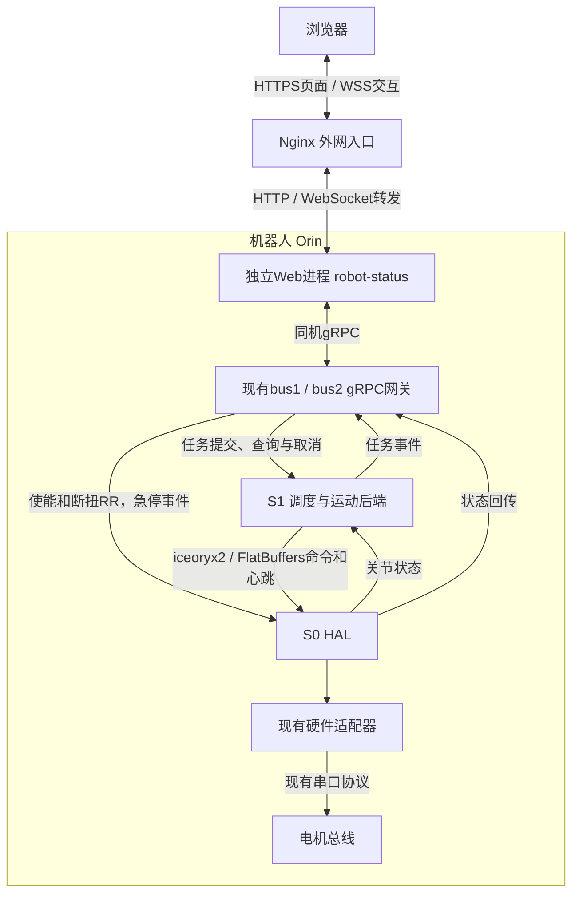

# 对外通讯与控制方案

Orin 上的一个 `robot-status` 为所有页面共享状态、相机和控制资源。bus1 对应左臂、夹爪和头部八个位置槽，bus2 对应右臂、夹爪六个位置槽及三个轮速槽。双侧网页单关节控制已有实机验收。双侧回位入口已部署，现场回位、腕点 IK 动作和底盘落地验证的边界见[当前状态](s0_hal_status.md)，实施顺序见[根目录待办](../TODO.md)。

## 通讯链路



浏览器通过同源 `/api/ws` 传状态、目标和回执，HTTP 传静态模型、最新相机帧和校准操作。每侧网关监听 Orin 回环地址。S0 负责硬件、安全状态和断扭，S1 负责目标生成及轨迹执行。网页连接数不改变每侧的 S1 实例、gRPC 客户端、机器人轮询、相机订阅和编码数。

每个控制请求沿用请求身份、版本、权限、截止时间与幂等检查。Web 使用机器人时钟换算截止时间，命令按源版本校验，同一请求只派发一次。断线或超时后重新连接查询已有任务和新鲜状态。控制网关凭据仅保存在机器人，浏览器访问由部署环境的外部入口管理。

## 已有对外接口

| 能力 | 调用与边界 |
|---|---|
| 状态 | `GetState`、`StreamState` 提供所选硬件的布局、位置、模式、扭矩状态、故障和源时间戳。源时间戳推进才产生新鲜反馈，断扭确认为总线级。 |
| 总线使能与断扭 | `SetEnabled(true/false)` 作用于整条所选总线。软件使能、扭矩读回和服务在线各自显示。 |
| 定位与回位 | `InvokeTask(kind=Scripted)` 承载单关节定位和单臂五轴回位。各侧任务独立，物理 ID 必须结合总线解释。 |
| 任务观察与取消 | `GetTaskStatus`、`StreamTaskEvents`、`CancelTask`。单关节任务和回位任务以新鲜反馈持续到位判成功，取消后保持最后成功发布的目标；首次发布前保持提交快照。原完整向量载荷保留自己的完成和取消语义。 |
| 急停 | `EStop` 回执表示事件已发布，还需检查实际停止。解除锁存使用独立的 maintainer 级 `ClearEStop`，使能须再次显式请求。 |

接口定义见 [robot_control.proto](../crates/robot-rpc/proto/robot_control.proto)。设备身份、轮角色、关节名和模式读自[总线配置](../configs/README.md)。

## 单关节定位

1. 在「关节」页选总线和位置关节，查看新鲜反馈及原位对齐状态。锁存时显式解除急停，再点「总线使能」。bus2 使能整条九槽总线，位置任务期间三轮目标保持 raw 0。
2. 拖动滑条可预览目标，松手或松键提交一次。输入目标数值则点「执行定位」。S1 从提交时的新鲜完整反馈起步，未选位置关节保持同帧位置。角度、速率、时长、编码后的目标及到位容差按[两侧运动配置](../configs/README.md#单关节运动约束)检查。
3. 在同一控制区查询任务结果。正常结束可显式断扭并按当次计划锁存急停。中途取消停止发布新的轨迹点，保持最后一次成功发布的目标；需要断扭时仍须点击「总线断扭」并检查反馈。

使能前，空闲 S1 仅在新鲜的 Safe、已确认断扭且无故障时对齐保持目标。Web 同时核对推进的反馈与 S1 命令镜像。各源的 `enable_alignment_tolerance_rad`、S0 校准边界容差和 S1 到位容差各有用途。本机位置任务按 ±20 raw、到位超时 800 毫秒、稳定窗口 200 毫秒确认。超时或未知结果先查原任务；Degraded 状态沿原维护入口处理。

CLI 使用 `robotctl invoke single-joint --hardware-id … --joint-name … --target-position-rad … --duration-ms … --audit-reason …`，沿现有 `0x040F` 载荷提交。超时预算须覆盖运动和到位观察。[CLI 实现](../crates/robot-cli/src/dispatch.rs)

### 网页单关节校准

**先标定电机。** 在「可视化」选一个位置关节，展开「校准单个电机」。现场支撑好机械臂，所选侧须已断扭并锁存急停。

1. 点「开启所选电机校准」，核对弹窗中的总线和关节。交接成功后，同侧的 S0/S1 让出总线，[校准进程](../scripts/joint_calibration.py)独占串口。
2. 把关节摆在**机械行程中间**，放手停稳后点标零。这一步立即将电机零偏写入 EEPROM，使参考位约为 2047 raw，并临时打开原限位。
3. 手动摆到实际最大位置和最小位置，两端可按任一顺序记录。每到一端，停稳后点击记录。核对两个读数，点保存，工具读回电机限位并更新该关节的校准文件。页面分别显示保存和总线归还结果。
4. 单圈位置的 0 和 4095 相邻。若读数从 0 附近跳到 4095 附近、反向跳变或出现单圈范围外的数，工具会保留原始读数并阻止保存这次行程。按页面提示恢复原校准，重新选取机械中位。请求超时先读状态；写入中断后用原关节进入恢复。

标定操作由[本机交接程序](../scripts/joint_calibration_handoff.py)组织。同侧 S0/S1 让出串口，保存或恢复后按交接结果归还。再次使能前核对该关节的 S1 主动目标范围；更新后的校准 JSON 在后续打包、安装时重新冻结身份。

**再对齐网页模型。** 在「可视化」选关节，展开「对齐网页模型」。以该关节的 URDF 零位和转轴为参考，摆两个明显不同的姿态，各输入实物角度（度）并记录。网页读取同一状态连接上的反馈，预览方向和零位修正。再摆第三个姿态，核对显示的角差，满意后保存。夹爪前两次分别记录闭合和张开，再用一个中间开度复核。保存结果位于 Orin 的 `/var/lib/robot-status/model-calibration.json`。其他浏览器重新进入可视化后共用这份修正，也可以逐关节恢复模型默认值。

### 单臂回初始位姿

参考姿态为上臂抬起、前臂朝车头伸出。肩水平、肩抬升、肘屈伸、腕俯仰、腕旋转对应的原模型角为 0°、90°、90°、0°、0°。S1 当前给五轴的目标均为电机空间 0 rad（本机 2047 raw）。网页模型对齐只改变显示。逐轴标零后，应先在参考姿态记录左右臂各自的五个读数，核对它们与 S1 目标的对应关系，再分侧做实机回位验收。

已确认目标和现场条件后，在「关节」页使能所选侧，再点该侧的「回初始位姿」。五轴从本次新鲜反馈同步插值，时长取 10 秒与各轴按限速移动所需时间的最大值，向上取整至毫秒。左侧沿 `0x0411` 保持左夹爪和头部，右侧沿 `0x0410` 保持右夹爪和三轮零速。到位沿用各轴配置，任务可查询、取消或急停。[S1 回位实现](../crates/robot-s1/src/single_joint.rs)

## 可视化、IK 与底盘

- **完整 URDF** 在「可视化」通过 WebGL 2 加载。部署需将 `ROBOT_STATUS_URDF_DIR` 指向包含 `xlerobot.urdf` 和 `meshes/` 的模型目录，版本对应 `dimos-deploy@9ece6bd`。后端启动时按[模型清单](../crates/robot-rpc/src/pose_assets/xlerobot.b3)核验文件。前端用状态快照更新关节，灰色表示缺少当前反馈；缩放、平移和复位视角只影响本地画布。
- **右臂腕点 IK 预览** 点击后取同一帧 bus2 的五轴反馈，计算腕俯仰轴在右肩坐标系沿 X 前移 10 毫米、再回到起点的两段目标。`GET /api/kinematics/right-arm/preview` 仅规划并返回模型结果或拒绝原因，右侧 S1 的九槽执行路径另行验收。[预览实现](../crates/robot-rpc/src/status_ik.rs)
- **底盘** 正式页面保留状态展示。方向按钮仅用于显式启用 `test-base-command` 和模拟配置的构建，复用右侧 S1，右臂保持原位。按住时由同一连接续租，松手请求停止，断线停止续租。三轮轮速组合已做架空验证，地面方向和停车距离待现场验证。[底盘控制实现](../crates/robot-rpc/src/status_base.rs)

## 当前WebSocket入口

网页静态资源随 `robot-status` 编译，完整 URDF 和网格按上述目录加载。本地开发可用同一个隔离目录构建与启动：

```sh
CARGO_TARGET_DIR="$PWD/target/verify-status" cargo build -p robot-rpc --features status-web --bin robot-status --bin robot-gateway
target/verify-status/debug/robot-status --config configs/xlerobot-status.toml
```

[仓库网页配置](../configs/xlerobot-status.toml)默认绑定 `127.0.0.1:8080`，关闭运动控制。配置可指定私网 IPv4 供现有 Nginx 转发。同机 gRPC 仍绑定回环地址，状态新鲜度使用机器人时钟。显式控制模式需本机凭据及同源写请求。候选准备、安装与回滚见[systemd 维护说明](../scripts/systemd/README.md#状态服务安装与回滚)。

| 传输 | 入口与用途 |
|---|---|
| WebSocket | `/api/ws` 推送最新共享快照，控制模式复用同一连接发送命令、收取回执。同一页面切换标签时复用连接。 |
| HTTP 只读 | `/`、`/assets/*`、`/api/state`、`/api/resources`、`/api/cameras`、`/api/cameras/{id}/frame` 和右臂 IK 预览。 |
| HTTP 校准 | `/api/calibration/model` 读写网页显示修正；`/api/calibration/motor/start` 申请交接，`/api/calibration/motor` 查询会话或执行显式维护步骤。电机写操作要求已开放控制的总线和同源请求。 |

外网由既有 Nginx 将同一站点的页面、静态资源、HTTP API 及 WebSocket 转到 Web 上游。保留原 Host 和 Origin，允许 WebSocket 升级；具体访问入口和接入管理在部署环境中维护。外网只读通过和本地浏览器经 Web 提交的实机动作分别验收，外网写入仍待验收。

WebSocket 最多 8 条连接，同一连接同时只允许一个控制请求。一个每源共享的 gRPC 客户端轮询状态并查询当前任务，循环按默认 500 毫秒运行。源反馈超过配置的 2000 毫秒展示阈值时标记陈旧，安全判断仍沿用机器人侧检查。

## 整机资源

一个普通线程每 2 秒更新共享资源快照，`GET /api/resources` 仅返回缓存。整机内存按 `MemTotal - MemAvailable` 统计，单服务按 cgroup v2 的 `memory.current` 统计。CPU 同时给出核数和归一化占比。进程数按 cgroup 去重，线程及上下文切换按 TID 核算；网络按接口列出，避免重复累计隧道和物理接口。[采样实现](../crates/robot-rpc/src/status_resources.rs)

## 相机预览

同一普通线程从头部和左右腕的 RGB 镜像读取最新帧，归还共享内存后再编码 JPEG，每路仅缓存最新图像。默认每路 1 Hz、最长 320×240、质量 70，源帧超过 3 秒标记陈旧。无有效帧或已过期返回 503。浏览器在「相机」独立查看或暂停，切后台或离开标签时回收请求。网页限额、预览频率和分辨率仅约束外部观测；S0 沿原配置采集。[相机预览实现](../crates/robot-rpc/src/status_camera.rs)
